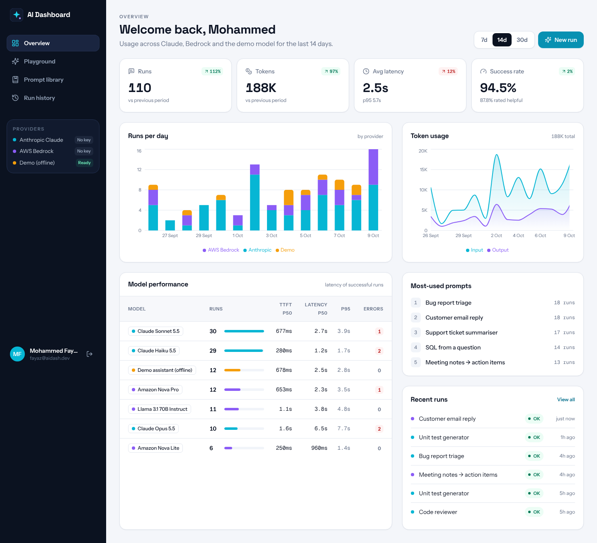
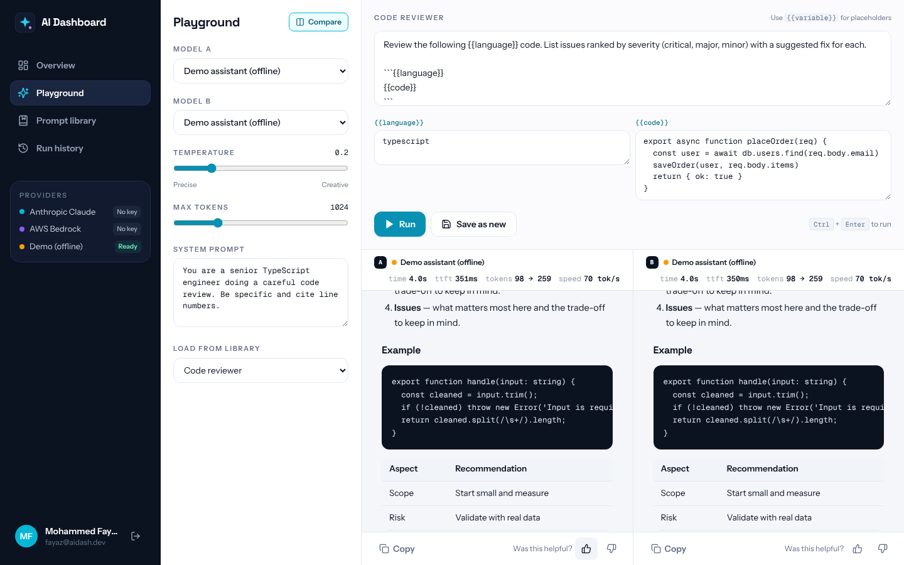
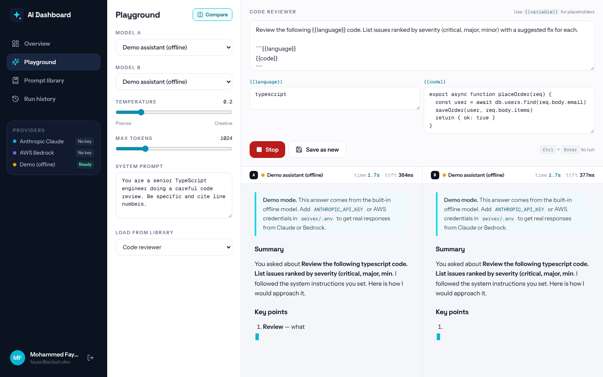
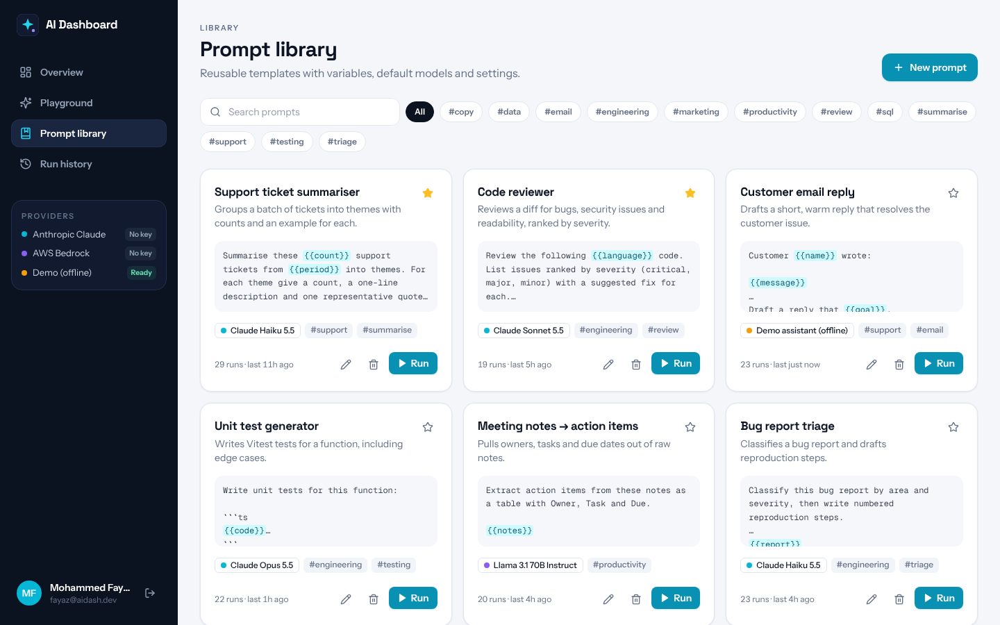
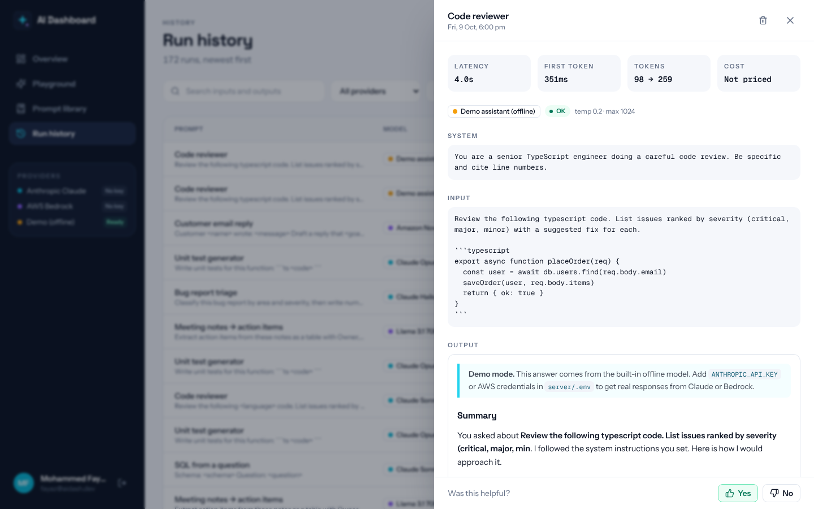
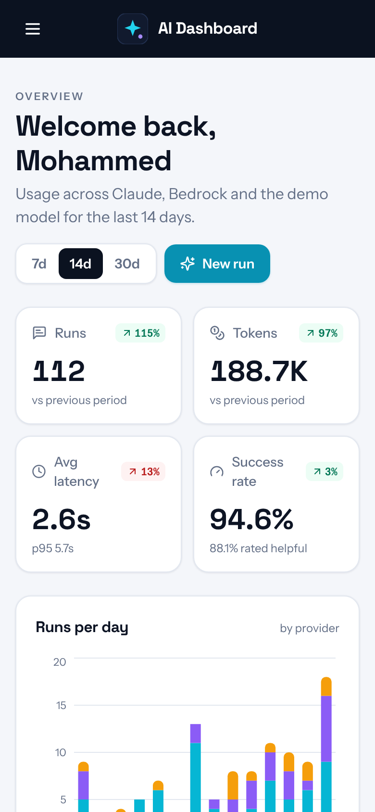

<div align="center">

# ✨ AI Dashboard

**A GenAI workbench for Claude and AWS Bedrock** — a streaming playground with side-by-side model comparison, a prompt library with `{{variables}}`, full run history and usage analytics.




</div>

## Features

**Playground**
- Streams responses token by token over Server-Sent Events, rendered as Markdown (tables, code, lists)
- **Compare mode:** run one prompt against two models at once, side by side
- Live metrics per response: total time, time to first token, input → output tokens and tokens per second
- Temperature, max tokens and system prompt controls; stop a run mid-stream
- Rate answers 👍 / 👎 to track quality over time

**Prompt library**
- Save prompts as templates with `{{variables}}`; the playground turns each variable into an input
- Default model, temperature and system prompt per template; tags, search and favourites
- Run counts and last-used time on every prompt

**History and analytics**
- Every run is stored with its input, output, model, timings, token usage and rating
- Search and filter by provider or status; open any run to see the full exchange
- Overview with runs per day by provider, token usage, model latency (p50, p95, time to first token), error counts, success rate and most-used prompts, compared with the previous period

**Providers**
- **Anthropic Claude** through the official `@anthropic-ai/sdk` (Messages API, streaming)
- **AWS Bedrock** through the Converse API, so Amazon Nova, Llama, Mistral or Claude-on-Bedrock all work with one code path
- **Demo model** that runs offline, so the whole app can be explored without any API keys

**Engineering**
- Provider abstraction (`server/src/lib/llm`) — adding a provider means implementing one `stream()` function
- Credentials stay on the server; the browser never sees an API key
- Analytics are computed in application code, so they work on MongoDB Atlas or any compatible store
- Zod validation, JWT auth, per-user data isolation, integration tests (including the SSE stream) and CI

## Screenshots

| Playground: compare mode | Streaming |
| --- | --- |
|  |  |
| **Prompt library** | **Run details** |
|  |  |

<p align="center"></p>

## Tech stack

| Layer | Tools |
| --- | --- |
| Frontend | React 18, TypeScript, Vite, TanStack Query, Recharts, React Markdown, React Router, Tailwind CSS, Framer Motion |
| Backend | Node.js, Express, `@anthropic-ai/sdk`, `@aws-sdk/client-bedrock-runtime`, Mongoose, Zod, JSON Web Tokens |
| Database | MongoDB |
| Testing & CI | Vitest, Supertest, GitHub Actions |

## Getting started

**Requirements:** Node.js 20+ and MongoDB (local, Docker or Atlas).

```bash
git clone https://github.com/mdfayaz25/ai-dashboard.git
cd ai-dashboard
npm install

docker compose up -d                 # or point MONGO_URI at Atlas
cp server/.env.example server/.env
npm run seed                         # demo user, 8 prompts and 30 days of sample runs
npm run dev                          # API on :5000, app on :5173
```

Sign in with `fayaz@aidash.dev` / `Demo@1234`. The seeded history is sample data so the charts have something to show; new runs you make are real.

### Connecting real models

Edit `server/.env`:

```bash
# Claude
ANTHROPIC_API_KEY=sk-ant-...

# AWS Bedrock (enable the models in the Bedrock console first)
BEDROCK_ENABLED=true
AWS_REGION=us-east-1
AWS_ACCESS_KEY_ID=...
AWS_SECRET_ACCESS_KEY=...
BEDROCK_MODELS=amazon.nova-pro-v1:0,amazon.nova-lite-v1:0
```

Restart the server; the sidebar shows each provider as **Ready**. Model lists live in `server/src/config/models.ts`.

### Cost estimates

Model prices change, so none are hard-coded. Add `pricing: { input, output }` (USD per million tokens) to a model in `server/src/config/models.ts` and the dashboard switches the Tokens card to an estimated cost and shows a cost per run.

### Scripts

| Command | What it does |
| --- | --- |
| `npm run dev` | Runs the API and the React app together |
| `npm run seed` | Resets the database with sample prompts and history |
| `npm test` | Runs the API integration tests |
| `npm run typecheck` | Type-checks server and client |
| `npm run build` then `npm start` | Production build; Express serves the React app |

## How streaming works

```
Browser ──POST /api/runs (fetch, Bearer token)──▶ Express
                                                    │  provider.stream(prompt, onDelta)
                                                    │     ├─ Claude: messages.stream()
                                                    │     ├─ Bedrock: ConverseStreamCommand
                                                    │     └─ Demo: local generator
◀── event: meta ─ event: delta × N ─ event: done ───┘  run saved with tokens + timings
```

The client reads the SSE stream with `fetch` and a `ReadableStream` reader (rather than `EventSource`) so it can send the auth header and abort with `AbortController`. Closing the stream aborts the upstream model call.

## API overview

| Method | Endpoint | Notes |
| --- | --- | --- |
| `GET` | `/api/providers` | Providers, models and whether each is configured |
| `POST` | `/api/runs` | Streams a response (SSE) |
| `GET` | `/api/runs?search&provider&status&page` | History |
| `PATCH` `DELETE` | `/api/runs/:id` | Rate or delete a run |
| `GET` `POST` `PATCH` `DELETE` | `/api/prompts[/:id]` | Prompt library |
| `GET` | `/api/analytics?days=7\|14\|30` | Aggregated usage |

## License

MIT © [Mohammed Fayaz](https://github.com/mdfayaz25)
